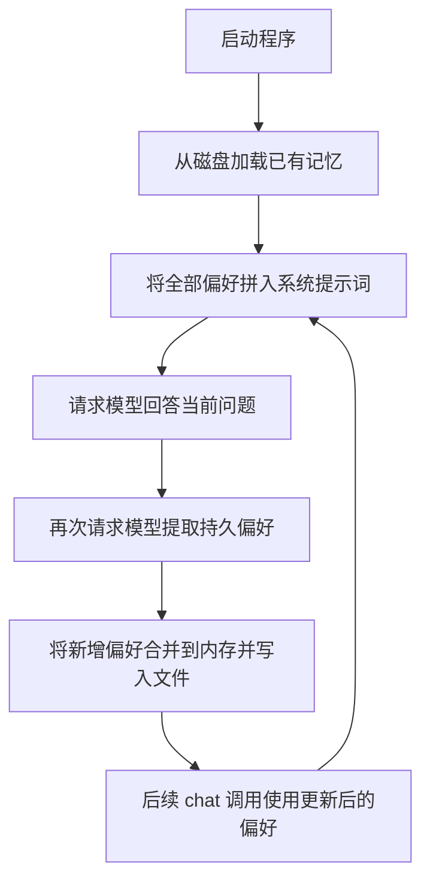

# 让 Agent 跨次运行记住偏好：长期记忆入门

这是 Agent 学习的第三站。入口 [demo_agent_memory.py](demo_agent_memory.py) 通过 Qwen 从对话中提取持久偏好，写入本地 JSON 文件，再将已有偏好加入后续请求，展示最小的长期记忆流程。

建议先阅读 [手写工具循环](../demo-function-loop/README.md) 和 [Agents SDK 工作流](../demo-openai-sdk/README.md)，再关注本例新增的问题：一次对话结束、甚至 Python 进程退出后，应用怎样继续使用以前获得的信息？本例使用 `openai` 客户端和普通 Python 函数，没有注册工具或使用 Agents SDK 的 `Runner`。

## 学完要能解释什么

- 当前会话的消息历史与跨会话的长期记忆有什么区别？
- 什么信息适合保存，谁从对话中提取这些信息？
- 模型怎样使用磁盘上的记忆，为什么仍需把内容加入请求？
- 全量注入、摘要压缩和按需检索分别解决什么问题？
- 记忆在本地保存，为什么仍会有内容发送给模型服务？

## 先区分三个概念

| 概念 | 含义 | 本示例的对应行为 |
| --- | --- | --- |
| 当前对话上下文 | 本次请求中提供的指令、用户输入及历史 | `chat()` 每次创建新的 `messages`，不传入之前的完整对话 |
| 长期记忆 | 跨任务或进程保留的有用信息 | 将偏好写入 `memory.json`，启动时重新加载 |
| 模型参数中的知识 | 模型训练形成的能力和知识 | 本例没有训练或微调模型 |

“长期”指应用能在之后重新取得这些信息。本例通过持久化和提示词重建实现这件事，模型每次回答时使用的是程序实际传入的内容。

## 沿着一次偏好更新读代码

入口依次调用两次 `chat()`：先说「我叫小王，以后就这么称呼我」，再问「今天天气怎么样」。以下流程假设记忆文件最初不存在，并且模型成功返回预期的偏好 JSON；实际措辞和抽取结果以运行结果为准。



### 1. 启动时加载

`memory = load_memory()` 在脚本加载时执行一次。文件不存在时返回 `{"preferences": []}`；文件存在时读取 JSON，得到应用内存中的字典。

之后每次 `chat()` 使用的是这个字典，不会重新读取磁盘。因此，程序运行期间手动编辑文件，不会自动更新当前进程里的记忆；重启后才会重新加载。

### 2. 回答前注入

`build_system_with_memory()` 将全部偏好拼成系统提示词。例如保存过称呼后，请求可能包含：

```text
你是一个助手。用户偏好如下，回答务必符合：称呼: 小王
```

这一步是字符串拼接，没有额外请求模型做总结，也没有按当前问题筛选记忆。偏好越多，每次请求携带的内容就越长。

### 3. 回答后抽取

`extract_and_save()` 将本次请求的消息、模型回复和偏好抽取指令一起发给 Qwen，请它返回 JSON 数组，例如：

```json
[{"key": "称呼", "value": "小王"}]
```

抽取工作由 Qwen 完成，何时抽取以及怎样保存由 Python 程序安排。返回值是面向持久偏好的结构化记录，原始对话不会被完整写入记忆文件。

### 4. 合并并保存

程序将新记录与 `memory["preferences"]` 中的字典逐条比较，只追加尚不存在的记录，再调用 `save_memory()` 写入文件。可能得到：

```json
{
  "preferences": [
    {"key": "称呼", "value": "小王"}
  ]
}
```

去重依据是字典是否完全相等。若后来用户要求改称「老王」，两条不同的记录可能同时存在；当前代码没有按 `key` 替换旧值，也没有实现过期或冲突处理。

## 函数与职责

| 函数 | 执行者 | 职责 |
| --- | --- | --- |
| `load_memory()` | Python 程序 | 从本地文件恢复偏好 |
| `build_system_with_memory()` | Python 程序 | 将全部偏好加入系统提示词 |
| `chat()` 中的首次模型请求 | Qwen | 根据偏好和当前问题生成答复 |
| `extract_and_save()` 中的模型请求 | Qwen | 从本次对话中提取持久偏好 |
| `save_memory()` | Python 程序 | 将更新后的字典持久化 |

正常完成一次 `chat()` 会发起两次模型请求：一次回答、一次抽取。默认入口调用两次 `chat()`，因此完整运行会发起四次请求。抽取同步发生在 `chat()` 返回之前，也会影响等待时间。

## 安装、配置与运行

需要 Python 3.13 或更高版本。以下命令均在项目根目录执行，使用根目录共用的依赖环境：

```bash
uv sync
```

若根目录已有可用 `.env`，本例可以直接复用。也可以在示例目录独立配置；首次创建时执行：

```bash
cp .env.example demo-agent-memory/.env
```

编辑所使用的 `.env`，填入适用于接口地址的 Key：

```dotenv
LLM_API_KEY="你的百炼 API Key"
LLM_MODEL_ID="qwen3.8-omni-flash"
LLM_BASE_URL="https://maas.qianwenaiapi.com/compatible-mode/v1"
```

已有系统环境变量优先。文件选择规则是：存在 `demo-agent-memory/.env` 时读取该文件，否则读取根目录 `.env`；不会把两份文件合并。若示例目录文件存在但 Key 为空，需要补全该文件。

`LLM_API_KEY` 和 `LLM_BASE_URL` 需要配置；`LLM_MODEL_ID` 省略时默认 `qwen3.8-omni-flash`。无需额外设置 `OPENAI_API_KEY`。

```bash
uv run demo-agent-memory/demo_agent_memory.py
```

当前没有交互输入模式；修改 `__main__` 中传给 `chat()` 的文本即可更换任务。

`MEMORY_FILE = "memory.json"` 是相对路径，以执行命令时的工作目录为准。按上述方式运行，记忆保存在**项目根目录的 `memory.json`**，而非示例目录。换一个工作目录运行会使用另一份文件。运行生成的 `memory.json` 已加入 Git 忽略规则。

本例没有天气查询工具，第二个问题只用于观察称呼等偏好是否影响答复，不能用它验证实时天气。

## 本地持久化与请求数据

磁盘文件由本地程序保存，没有调用云端记忆库。每次回答会发送全部已保存偏好，随后偏好抽取请求还会发送本次消息及答复。因此，本地持久化不代表内容没有离开设备。

服务商如何处理请求日志、保留数据属于另一层政策；不能从本地文件实现推出“服务端绝不保存”。百炼官方对数据处理的说明见 [模型调用数据相关 FAQ](https://help.aliyun.com/zh/model-studio/faq-about-alibaba-cloud-model-studio)。

## 与实际 Agent 记忆系统对照

本例只展示“提取偏好 → 持久化 → 全量注入”的基础流程。真实系统可以按需要组合以下机制：

| 机制 | 解决的问题 | 本例状态 |
| --- | --- | --- |
| 偏好提取 | 从新交互中提取可复用信息 | 已实现额外模型请求 |
| 记忆整理 | 更新旧事实、合并重复含义、处理冲突 | 仅对完全相同的记录去重 |
| 精简档案 | 将少量核心信息常驻上下文 | 使用全部偏好，未限制大小 |
| 按需检索 | 从大量记录中选取与本次任务相关的部分 | 未实现 |
| 后台处理 | 将提取或整理移出当前回答的等待流程 | 未实现，当前同步处理 |
| 对话压缩 | 缩短当前会话的历史上下文 | 未实现，也不同于跨会话记忆 |

整理可以由应用额外调用 LLM 完成，检索也可以由数据库的关键词、语义搜索或过滤机制完成，并不要求每次请求前把所有历史重新总结一遍。可继续阅读 [LangMem 的记忆形成与检索机制](https://langchain-ai.github.io/langmem/concepts/conceptual_guide/) 和 [LangGraph 的短期、长期记忆概念](https://docs.langchain.com/oss/python/concepts/memory)。

## 建议的代码阅读顺序

1. 看 `__main__` 中两次 `chat()`，确认本次示例要观察什么。
2. 看 `load_memory()` 和 `save_memory()`，定位文件、进程内状态及读写时机。
3. 看 `build_system_with_memory()`，找出记忆进入模型请求的具体位置。
4. 看 `extract_and_save()`，区分模型生成记录与程序保存记录的职责。
5. 最后看 `chat()`，串起回答、抽取、更新以及下一次调用的数据流。

## 动手练习

| 练习 | 怎么做 | 重点观察什么 |
| --- | --- | --- |
| 验证跨进程记忆 | 首次保存称呼后，把入口改成只问「你应该怎么称呼我」，再运行 | 没有重发原始自我介绍时，文件是否提供了所需偏好 |
| 追踪请求内容 | 临时打印 `build_system_with_memory()` 的返回值 | 偏好是通过哪条消息进入模型上下文的 |
| 观察冲突 | 先要求称呼小王，再要求改称老王，检查本地 JSON | 完全相等去重为何无法替代更新旧值 |
| 区分记忆和对话历史 | 询问只在上一轮出现过、但没有被提取成偏好的临时信息 | 新请求没有完整上一轮对话时，哪些信息不可用 |
| 理解整理成本 | 在不发真实请求的模拟测试中统计客户端调用次数 | 一次聊天背后的回答与抽取是两次独立模型请求 |
| 设计按需检索 | 设想偏好增长到大量记录，列出本次问题真正需要的字段 | 哪些应常驻、哪些应检索，而不是全部发送 |

重复运行默认入口会再次明确提供“小王”这一称呼，仅凭默认输出不足以证明跨进程记忆生效。应按第一个练习移除重复介绍，并结合文件内容和实际请求验证。

## 当前实现的边界与学习检查

抽取返回值的解析、合并及写入异常会被忽略，但抽取 API 请求位于 `try` 之外，网络异常仍会中断调用。文件加载也没有处理损坏的 JSON；保存使用直接覆盖，未实现并发写入和原子更新。当前数据只有一份共享偏好列表，没有用户隔离和结构校验。

学习时先能回答：文件在何处？何时读取？一次聊天请求几次模型？发送的是原始历史还是提取后的全部偏好？用户改变偏好时旧记录会怎样？

接下来可以每次只改进一个环节：先处理同字段更新，再增加结构校验，随后尝试受长度限制的档案或按需检索。用可核对的输入和文件状态验证变化，再决定是否需要更复杂的记忆系统。
