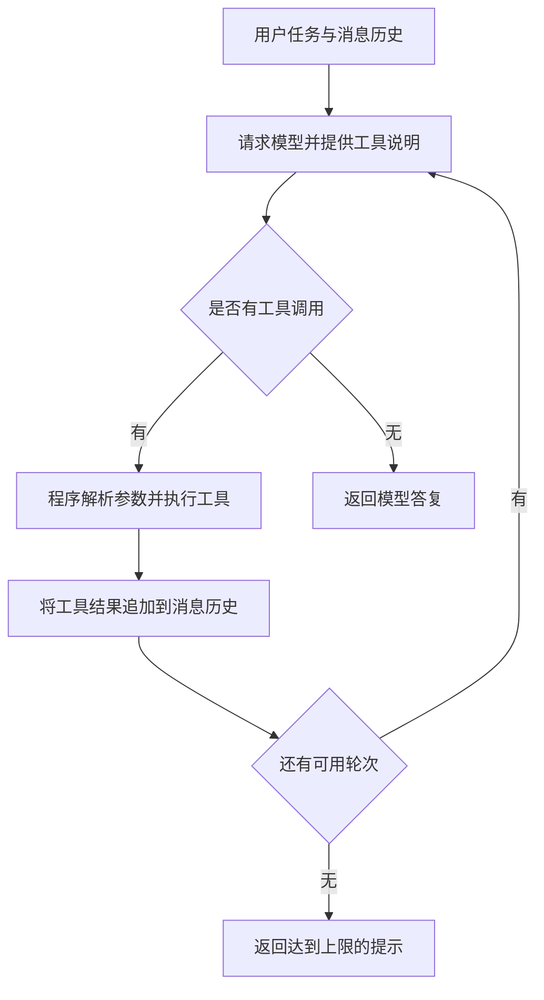

# 从零理解 Agent：手写 Function Calling 循环

这是 Agent 学习的第一站。通过 `openai` Python SDK 调用 Qwen，手动实现「请求模型 → 执行工具 → 回传结果 → 继续请求」的循环。入口为 [demo_function_loop.py](demo_function_loop.py)。

建议先学本示例，再阅读 [Agents SDK 示例](../demo-openai-sdk/README.md)。先能解释一轮工具调用中的数据流，再看框架如何接管重复工作。

## 学完要能解释什么

- 普通模型请求怎样扩展成可以使用工具、连续完成任务的程序？
- 模型如何知道有哪些工具，又是谁真正执行工具？
- 为什么工具执行完后，还要再次请求模型？
- Agent 如何保存一次任务的上下文，什么时候停止？

## 从一次问答到一个执行循环

入口脚本最前面的自我介绍请求只发送 `messages`，拿到文本后就打印。接下来的 `run_agent()` 多了工具说明、工具执行和结果回传：模型可以根据当前信息提出下一步工具调用，程序执行后，再让模型根据结果继续处理任务。

在这个示例中，可以把 Agent 拆成以下几个部分理解：

| 部分 | 本项目中的位置 | 负责什么 |
| --- | --- | --- |
| 模型 | `client.chat.completions.create()` | 根据输入决定回复内容或提出工具调用 |
| 行为约定 | `SYSTEM` | 描述任务、工具使用要求和回答方式 |
| 工具接口 | `TOOLS` | 告诉模型工具名称、用途、参数结构 |
| 执行能力 | `TOOLS_IMPL` 和工具函数 | 将模型提出的调用变成真实计算、网络请求或文件读取 |
| 当前任务的状态 | `messages` | 保存用户输入、模型回复和工具结果 |
| 控制循环 | `run_agent()` | 在请求、执行和回传之间推进，并处理停止条件 |

这里的关键是把工具结果带回后续决策。增加一段角色提示词能改变模型回答方式；增加这条执行循环，才能让程序根据外部结果继续完成任务。



模型返回的是工具调用请求，Python 程序负责执行函数。这种分工可对照 [OpenAI 官方 Function Calling 说明](https://developers.openai.com/api/docs/guides/function-calling)；本项目使用其中的 Chat Completions 消息格式。

## 沿着一次计算读代码

以「计算 `(328+457)*12`」为例，下面是一条可能的执行轨迹，用于理解字段含义，并非实际运行日志：

1. `messages` 先放入 `system` 行为约定和 `user` 任务，随后与 `TOOLS` 一起发给模型。
2. 模型返回一条 `assistant` 消息，其中的 `tool_calls` 指定 `calculator`，参数为 JSON 字符串 `{"expression":"(328+457)*12"}`。
3. `messages.append(msg)` 保存这条调用请求。后续工具结果需要与它配对，因此不能只保存最终文本。
4. 程序通过 `TOOLS_IMPL[call.function.name]` 找到函数，用 `json.loads()` 将参数转成字典，再通过 `fn(**args)` 真正执行计算。
5. 程序追加一条 `role="tool"` 的消息，结果为字符串 `"9420"`，并用 `tool_call_id=call.id` 标明它回答的是哪次调用。
6. 下一轮模型同时看到原始问题、自己的调用请求和结果，才有条件生成最终回答。若它继续请求工具，程序继续循环。

一条模型回复可能包含多个工具调用，因此代码使用 `for call in msg.tool_calls`。当前实现逐个执行它们；模型一次提出多个调用，不代表程序已并行执行。

### 工具说明与工具实现为何要分开

打开 [tools_manual.py](../tools/tools_manual.py)，对照 `TOOLS` 和 `TOOLS_IMPL`：

| 定义 | 读者或使用者 | 需要关注的内容 |
| --- | --- | --- |
| `TOOLS` | 模型 | `name` 选哪个工具，`description` 何时使用，`parameters` 如何传参 |
| `TOOLS_IMPL` | Python 程序 | 根据工具名称找到可以调用的函数对象 |
| 工具函数 | Python 运行时 | 接收参数、访问数据或执行操作、返回结果 |

例如 `query_weather` 的说明承诺返回未来三天天气，实际函数就要完成城市定位和天气查询。说明写得清楚有助于模型选择工具，但真实结果仍取决于工具实现和外部服务。

JSON Schema 描述参数结构，不能替代执行前的业务校验。当前循环会直接解析并调用；未知工具名、非法 JSON 或不匹配的参数仍可能抛出异常。读代码时要区分工具内部捕获的错误与调度循环尚未处理的错误。

### 消息历史与停止条件

`messages` 是本次任务的上下文。每次请求都携带逐步累积的历史，工具结果因此能影响下一轮输出。这是在应用侧保存并传递状态，不会因此修改模型参数。

每次调用 `run_agent()` 都重新创建消息列表，所以交互界面中的下一次输入不会自动继承上次任务。若想让「刚才那个结果再乘 2」接续上一问，需要另外设计跨任务的历史保存。

当前循环有两种正常结束方式：没有 `tool_calls` 时返回模型答复；达到 `max_steps` 时返回未完成提示。默认 6 步指最多 6 次循环中的模型请求，不是最多执行 6 个工具。若最后一轮仍调用工具，其结果会被保存，但不会再有一轮模型请求整理答案。

## 建议的代码阅读顺序

1. 看入口脚本的自我介绍请求，认识最基本的 `model`、`messages` 和回复结构。
2. 看 `SYSTEM`、`TOOLS`、`TOOLS_IMPL`，分清行为约定、工具接口和可执行函数。
3. 看 `run_agent()`，按上面的计算轨迹追踪每次 `messages.append()`。
4. 看 [calculator.py](../tools/calculator.py)，先理解一个不依赖网络的工具。
5. 再看天气和文件工具，观察网络失败、数据不存在、返回内容长度等问题如何进入工具结果。

## 安装与配置

以下命令均在项目根目录执行，两个示例共用根目录的 `pyproject.toml` 和虚拟环境，需要 Python 3.13 或更高版本。

```bash
uv sync
cp .env.example demo-function-loop/.env
```

编辑 `demo-function-loop/.env`，填写适用于接口地址的 API Key：

```dotenv
DASHSCOPE_API_KEY="你的百炼 API Key"
QWEN_MODEL="qwen3.8-omni-flash"
DASHSCOPE_BASE_URL="https://maas.qianwenaiapi.com/compatible-mode/v1"
```

脚本读取的是本目录的 `.env`，不会自动读取项目根目录的 `.env`；已有系统环境变量优先。`DASHSCOPE_API_KEY` 和 `DASHSCOPE_BASE_URL` 需要配置，`QWEN_MODEL` 省略时使用 `qwen3.8-omni-flash`，模型需支持工具调用。`.env` 已由根目录的 Git 忽略规则排除。

## 运行

```bash
PYTHONPATH=. uv run demo-function-loop/demo_function_loop.py
```

`PYTHONPATH=.` 用于导入项目根目录的 `tools` 包，因此请在项目根目录执行。

程序会先发送一次自我介绍请求，然后进入交互模式，例如输入：

```text
计算 (328+457)*12
查询北京未来三天的天气
读取 calculator.py 的内容
```

输入 `q` 退出。每次输入会创建新的消息列表，不保留上一次任务的对话历史。每个任务默认最多请求模型 6 轮，调用工具时会打印工具名称和参数。

## 工具与执行流程

工具由根目录的 [tools/tools_manual.py](../tools/tools_manual.py) 统一定义：

| 工具 | 实现文件 | 功能 |
| --- | --- | --- |
| `calculator` | [calculator.py](../tools/calculator.py) | 计算加减乘除、括号和负数表达式 |
| `query_weather` | [query_weather.py](../tools/query_weather.py) | 调用 Open-Meteo 查询城市未来三天天气，需要网络 |
| `read_file` | [read_file.py](../tools/read_file.py) | 读取根目录 `tools/` 下的文本文件，最多返回 3000 个字符 |

`TOOLS` 是发给模型的工具名称、用途和参数说明；`TOOLS_IMPL` 将工具名称映射到实际 Python 函数。新增工具时，需要同时维护工具函数、这两份定义以及入口脚本的 `SYSTEM` 提示词。

`run_agent()` 在每一轮把消息历史和 `TOOLS` 发给模型：有工具调用时，解析 JSON 参数、执行对应函数，再携带 `tool_call_id` 回传结果；没有工具调用时，返回模型的最终答复。达到最大轮数后返回未完成提示。

## 动手练习：每次只改变一个变量

| 练习 | 怎么做 | 重点观察什么 |
| --- | --- | --- |
| 追踪一轮调用 | 输入 `计算 (328+457)*12`，临时打印 `msg.tool_calls` 和回传的工具消息 | 模型产出的函数名、JSON 参数、调用 ID 如何连接到结果 |
| 观察反馈 | 输入 `计算 1/0` | 工具返回的失败信息能否帮助模型解释问题；真实措辞以运行结果为准 |
| 制造信息依赖 | 在根目录 `tools/` 放一个写有算式的文本文件，再要求读取并计算 | 后一个工具能否使用前一个工具刚返回的信息 |
| 理解轮次上限 | 临时将一次任务的 `max_steps` 设为 1，再输入计算请求 | 工具执行成功与任务生成最终答案是两个不同阶段 |
| 验证记忆范围 | 先计算一个结果，再单独输入「把刚才的结果乘 2」 | 新任务的消息列表里是否真的含有上一次结果 |
| 增加一个工具 | 实现温度换算函数，并补充 schema、函数映射和提示词 | 函数名、参数名和类型必须在整条调用链上保持一致 |

模型的选择并非每次相同，练习时以调用记录和工具返回为准。提示词中的「必须调用工具」是给模型的指令；本例没有额外的执行后校验来强制落实它。

## 学习检查与下一步

读完后，尝试不看代码解释：为什么要先保存 `assistant` 调用消息？`TOOLS` 为什么不能直接执行？`tool_call_id` 连接了什么？任务轮次用完但还没有答案时，程序会怎样结束？

然后进入 [Agents SDK 示例](../demo-openai-sdk/README.md)，逐项寻找这些手写步骤在 SDK 中的对应位置。本例展示了基本执行循环，跨任务记忆、参数校验和执行预算等仍需要应用继续设计；练习代码时不要把提示词当作工具的权限控制。
