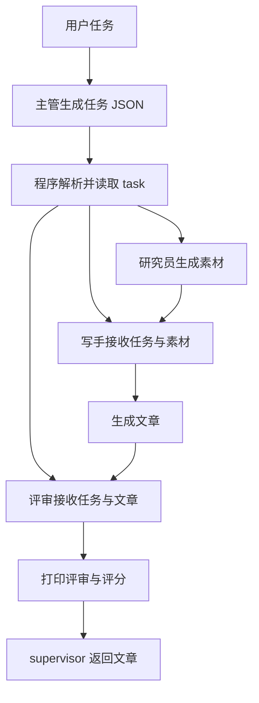

# 理解多 Agent 协作：主管、研究员、写手与评审

入口为 [demo_openai_sdk_multiagent.py](demo_openai_sdk_multiagent.py)。本例围绕写作任务，把处理过程拆成四个角色：主管确认任务，研究员生成素材，写手撰写文章，评审给出意见和评分。

目录名包含 `sdk`，当前代码使用的是 `openai` Python 客户端，通过普通函数连接模型请求，没有使用 `openai-agents` 的 `Agent`、`Runner` 或 handoff。适合先理解多角色的职责和数据流，再对照 [Agents SDK 示例](../demo-openai-sdk/README.md) 学习框架表达方式。

## 学完要能解释什么

- 多个角色是否一定需要多个模型，角色之间如何产生区别？
- 主管模型提出的内容与 Python 程序决定的执行顺序有何区别？
- 上一个角色的结果如何成为下一个角色的输入？
- 多个角色共用客户端，是否意味着自动共享完整对话？
- 评审完成后，为什么文章没有自动重写？

## 先从任务与角色分工理解

默认任务是「写一篇介绍 AI Agent 未来发展趋势的短文」。四个角色共用 `client` 和 `MODEL`，通过不同的系统提示词和用户消息承担不同职责：

| 角色 | 代码入口 | 输入 | 输出 |
| --- | --- | --- | --- |
| 主管 | `llm(SUPERVISOR_SYSTEM, ...)` | 用户任务 | 包含 `task` 字段的 JSON 文本 |
| 研究员 | `researcher(task)` | 主管返回的任务 | 核心结论、支持依据和风险或不确定性 |
| 写手 | `writer(material, task)` | 任务及完整研究素材 | 目标约 300 字的中文文章 |
| 评审 | `reviewer(artical, task)` | 任务及完整文章 | 自然语言评审和评分 |

角色之间没有分别训练模型。相同模型可以因为指令、上下文和输出要求不同而承担不同工作，但角色名称与提示词不会保证产出一定符合要求。

这里的“研究员”依据模型已有知识生成素材，没有搜索工具或外部数据源。提示词要求标明推测，也需要结合实际输出检查，不能将“研究”阶段的文字直接视为已核实事实。

## 沿着数据流读一次执行



### 1. 主管确认任务，程序决定顺序

`supervisor(user_task)` 首先请求模型返回如下形式的 JSON，随后交给 `parse_json()`：

```json
{"task": "写一篇介绍 AI Agent 未来发展趋势的短文"}
```

虽然 `SUPERVISOR_SYSTEM` 描述了拆解和安排子任务，实际要求的输出只有 `task` 字段。当前模型没有返回可执行的步骤列表，程序也不会根据它动态选择工人。

真正的顺序写在 `supervisor()` 中：

```text
主管模型请求 → parse_json → researcher → writer → reviewer
```

因此，本例展示的是固定的多角色流水线。把模型称为“主管”，不代表它已经拥有自主路由、修改流程或并行调度的能力。

### 2. 研究素材传给写手

`researcher(plan["task"])` 返回素材，保存到局部变量 `material`。程序为了方便查看，只打印前 200 个字符，但随后 `writer(material, plan["task"])` 接收的是完整素材。

写手消息包含原始任务和素材两个部分。原始任务帮助它保留文章目标，素材提供待组织的内容；约 300 字是提示词要求，代码没有统计字数或强制截断。

### 3. 文章传给评审

`reviewer(article, plan["task"])` 接收文章和任务，不会自动获得主管、研究员及写手的全部消息历史。它没有搜索工具，也未直接接收完整研究素材，能使用的信息以实际请求为准。

当前评审提示词只要求审查和打分，没有规定评分范围、评分维度或 JSON 输出结构。因此，评分是自由文本，程序只负责打印，没有解析分数或判断通过与否。

### 4. 区分打印结果与函数返回值

`supervisor()` 会打印素材摘要、完整文章和评审结果，最终 `return article` 只返回文章。后续代码若需要自动处理评分，必须另外设计返回结构。

当前流程在评审后结束，没有将意见交给写手重新生成文章，也没有由主管汇总一版新的最终答复。

## 模型调用与上下文

`llm(system, user)` 是所有角色共用的请求函数，每次只创建两条消息：一条 `system` 指令和一条 `user` 输入。它不会累积此前的 `messages`。

所以，多角色之间的信息共享依靠函数参数显式传递，不能从“共用客户端或模型”推断它们共享全部历史。本例也没有持久化记忆；如需对照跨次运行保存信息的机制，可阅读 [长期记忆示例](../demo-agent-memory/README.md)。

正常完成一轮 `supervisor()` 会发起四次串行模型请求，每个角色一次。多个角色增加了职责划分，也增加了请求次数；本例没有并行执行、工具循环或自动重试。

## 与其他编排方式对照

| 方式 | 下一步由谁决定 | 本例是否实现 |
| --- | --- | --- |
| 固定流水线 | Python 代码规定角色顺序和数据传递 | 已实现 |
| 动态路由 | 模型生成选择，程序校验后分派到对应角色 | 未实现 |
| 主管将专家作为工具调用 | 主管保留主导权，按需要请求专家完成局部工作 | 未实现 |
| Handoff | 将当前工作或对话控制权交给其他角色 | 未实现 |
| 评审返工 | 程序按评审结果安排修改并限制返工次数 | 未实现 |

后续使用 Agents SDK 时，可以对照 [OpenAI 官方编排与交接说明](https://developers.openai.com/api/docs/guides/agents/orchestration) 理解 agents-as-tools 与 handoff 的职责差异。选择哪种机制，取决于谁应该控制下一步以及谁负责最终回复。

## 安装、配置与运行

需要 Python 3.13 或更高版本。以下命令均在项目根目录执行，使用根目录共用的依赖环境：

```bash
uv sync
```

本例优先读取 `demo-openai-sdk-multiagent/.env`；该文件不存在时读取根目录 `.env`。如果根目录配置已可用，可以直接运行。若希望单独配置，首次创建时执行：

```bash
cp .env.example demo-openai-sdk-multiagent/.env
```

已有 `.env` 时直接编辑现有文件，填写：

```dotenv
DASHSCOPE_API_KEY="你的百炼 API Key"
QWEN_MODEL="qwen3.8-omni-flash"
DASHSCOPE_BASE_URL="https://maas.qianwenaiapi.com/compatible-mode/v1"
```

`DASHSCOPE_API_KEY` 和 `DASHSCOPE_BASE_URL` 需要配置；`QWEN_MODEL` 省略时默认 `qwen3.8-omni-flash`。无需设置 `OPENAI_API_KEY`。

文件选择后只读取一份 `.env`，不会把示例目录与根目录配置合并；系统环境变量优先。如果本目录文件存在但 Key 为空，需要补全该文件。

```bash
uv run demo-openai-sdk-multiagent/demo_openai_sdk_multiagent.py
```

当前没有交互输入、命令行参数或流式模式。修改入口 `__main__` 中 `supervisor(...)` 的任务字符串即可更换主题。程序不会写入文章文件，需要保存结果时再由调用方处理。

## 建议的代码阅读顺序

1. 先看 `__main__` 和 `supervisor()`，确认完整阶段与返回值。
2. 看 `llm()`，理解一次角色调用实际发送了哪些消息。
3. 对照 `researcher()`、`writer()` 和 `reviewer()`，比较指令、输入与输出要求。
4. 回到 `supervisor()`，追踪 `plan`、`material`、`article` 和 `result` 的传递。
5. 最后看 `SUPERVISOR_SYSTEM` 和 `parse_json()`，区分模型输出的约定与程序执行的校验。

## 动手练习

| 练习 | 怎么做 | 重点观察什么 |
| --- | --- | --- |
| 追踪上下文 | 模拟请求时检查四次调用的 `messages` | 每个角色具体收到什么，哪些信息并未传递 |
| 改变评审标准 | 在评审提示词中明确逻辑、可读性和事实依据三个维度 | 相同模型如何根据不同职责生成输出，要求是否真正落实 |
| 比较任务传递 | 临时移除写手或评审输入中的原始任务并比较结果 | 仅看到中间产物时，后续角色能否判断是否偏题 |
| 验证日志与真实输入 | 让模拟研究素材超过 200 个字符 | 控制台截短展示不等于传给写手的数据被截短 |
| 设计结构化评审 | 先规定包含分数、问题列表和通过状态的 schema | 自由文本如何变成可供程序判断的结果 |
| 设计返工流程 | 画出评审不通过后将文章和意见交回写手的数据流 | 谁判断通过、最多返工几次、最终返回哪些内容 |

最后两项属于后续改造，当前代码尚未实现。尝试动态路由前，也应先确定允许调用的角色、参数格式和失败处理方式。

## 当前边界与学习检查

`parse_json()` 仅做简单的首尾空白及 Markdown 小写 `json` 代码围栏去除，再交给 `json.loads()`；它没有校验 `task` 的类型和内容。无效 JSON、缺少字段或请求异常可能中断整个流程。评审也没有外部核验能力，不能因为同一模型换了角色就认为事实已被独立证实。

读完后，尝试解释：哪个函数决定角色顺序？主管返回了真正的计划吗？四个角色分别看到哪些数据？控制台显示的评分为什么没有影响返回文章？如果要让主管根据任务自主选择专家，还需要增加什么程序逻辑？

理解这些问题后，再选择引入动态路由、结构化评审、有限次数返工或 SDK 抽象，每次增加一个机制并核对调用轨迹。
