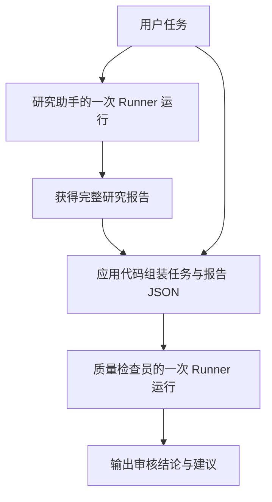

# 从手写循环到框架编排：OpenAI Agents SDK

这是 Agent 学习的第二站。通过 `openai-agents` 定义研究助手和质量检查员，使用阿里云百炼的 OpenAI 兼容接口调用 Qwen。入口为 [demo_openai_agent_sdk.py](demo_openai_agent_sdk.py)。

建议先阅读 [手写循环示例](../demo-function-loop/README.md)，理解工具调用和消息回传，再学习如何把这些工作交给框架，以及哪些应用逻辑仍需自己编写。

## 学完要能解释什么

- `Agent`、模型客户端和 `Runner` 各自负责什么？
- `@function_tool` 如何替代手写的工具说明和函数映射？
- 同一个模型为什么可以承担研究和审核两种角色？
- Agent 内部的工具循环，与多个 Agent 之间的工作流程有何区别？
- 为什么流式事件能帮助排查问题，却不能直接证明答案正确？

## 先把两份代码对上

两个示例的任务不同：手写版本处理交互式计算、天气和文件任务，SDK 版本生成并审核研究报告。下面比较的是执行机制，并非两个示例会输出相同结果。

| 手写循环中的工作 | 本示例的对应位置 | 学习重点 |
| --- | --- | --- |
| `SYSTEM` 行为约定 | `Agent(instructions=...)` | 为每个角色定义目标、规则和输出要求 |
| 手写 `TOOLS` 参数说明 | `@function_tool`、函数签名和文档字符串 | 通过 Python 函数声明工具接口 |
| `TOOLS_IMPL` 加函数分发 | 注册在 `Agent.tools` 中的工具对象 | SDK 连接工具说明与执行入口 |
| 反复请求模型、执行工具、回传结果 | `Runner.run()` / `Runner.run_streamed()` | SDK 管理单次运行内部的 Agent 循环 |
| 手动累积本次运行的 `messages` | Runner 管理的运行历史 | 仍需自己设计跨次运行的上下文传递 |
| 模型最终回复 | `result.final_output` | 提取结果，供展示或下一阶段使用 |
| 多个阶段怎样连接 | `main()` | 应用代码决定研究之后执行审核，并传递材料 |

`Runner` 接管的循环仍然包含模型请求、工具执行和继续请求等步骤，可对照 [OpenAI 官方运行机制说明](https://developers.openai.com/api/docs/guides/agents/running-agents)。理解这层封装后，调试时就能区分模型选择、工具实现和流程连接的问题。

## 分清三层职责

### 模型接入：请求发给谁

`create_qwen_model()` 将三层对象连起来：`AsyncOpenAI` 配置认证和接口地址，`OpenAIChatCompletionsModel` 将这个客户端接入 Agents SDK，`Agent.model` 决定角色使用哪个模型。

因此，安装 `openai-agents` 后仍能看到 `openai` 的客户端。一个负责模型 API 请求，一个在其上组织运行流程。这里使用 Qwen 的兼容接口，框架名称并不代表实际调用的是 OpenAI 模型；具体接口、工具调用和模型设置是否兼容，仍需目标服务支持。

### Agent 定义：这个角色要做什么

| 字段 | 本项目中的含义 | 容易混淆的地方 |
| --- | --- | --- |
| `name` | 研究助手或质量检查员的标识 | 只改名字不会自动产生新能力 |
| `instructions` | 定义研究方法、审核标准、输出格式 | 文本要求需要运行结果验证，不能当作质量保证 |
| `tools` | 为该角色提供可调用工具 | 研究助手可搜索和统计文本，检查员只注册搜索工具 |
| `model` | 该角色使用的模型对象 | 两个角色可以共用同一个模型 |
| `model_settings` | 请求时的模型设置 | 本例设置 `reasoning.effort="low"`，不是应用代码中的任务计划 |

本例的角色差异来自各自的指令、工具和输入。它们没有分别训练模型，也不会因为共享 `model` 对象就自动共享对话历史。Agent 配置的概念可对照 [OpenAI 官方 Agent 定义说明](https://developers.openai.com/api/docs/guides/agents/define-agents)。

代码中被注释的 `prompt={...}` 展示的是引用 OpenAI 平台已存提示词模板的配置形式，本示例实际使用的是 `instructions`。注释里的模板 ID 不可直接运行。

### 工作流编排：结果交给谁

本项目存在内外两层控制流程：

- 每个 Agent 内部，由 `Runner` 管理多轮模型请求和工具调用。
- 两个 Agent 之间，由 `main()` 明确安排先研究、再审核。



这是代码预先安排的顺序工作流。当前代码没有配置 handoff，也没有让研究助手自己决定交接对象；审核未通过后，程序同样不会自动让研究助手重写。

`checker_input` 同时包含 `user_input` 与 `research_report`：前者让检查员知道原始目标，后者提供待审材料。JSON 便于区分字段，但不会自动消除材料中的不可信指令，代码另用检查员的提示词要求将其视作待审内容。

## 工具、上下文和事件如何串起来

### 从普通函数到模型可用的工具

阅读 `search_web(query: str) -> str` 和 `analyze_text(text: str) -> str`，先看参数类型、文档字符串和返回值，再看 `@function_tool`。装饰器把函数包装成 SDK 可注册的工具，工具名称、用途和参数结构由函数声明提供线索；`Agent.tools` 决定哪些角色能使用它。

可以把它与手写版 `TOOLS` 和 `TOOLS_IMPL` 对照理解。包装省掉接口与实现之间的重复连接，函数本身仍需处理数据、网络和业务错误。本例 `analyze_text` 实际只统计字符及按空白分割的词数，不会自动分析语义；中文连续文本的这个“词数”也不等于中文分词结果。

### 返回最终结果不等于只调用一次模型

`await Runner.run(...)` 返回时，内部可能已经执行过多轮模型请求和工具调用。`result.final_output` 是这次运行的最终输出，不是每一个中间事件。

当前两次运行之间，程序只传递原始任务和完整研究报告，研究助手内部的工具消息不会作为完整运行历史直接交给检查员。本例也没有配置跨任务的持久化 Session；角色对象一直存在，不等于对话状态会自动永久保存。

### 用流式事件观察执行

`--stream` 让应用消费执行期间的事件，展示逻辑位于本项目的 `run_agent()`：

| 事件 | 本项目的处理 | 可以帮助判断什么 |
| --- | --- | --- |
| `response.output_text.delta` | 追加打印正文片段 | 模型正在产生哪些对外文本 |
| `tool_called` | 打印工具名、调用 ID 和参数摘要 | 模型选择了哪个工具、准备传什么参数 |
| `tool_output` | 按调用 ID 匹配工具并打印结果摘要 | 外部工具实际返回了什么 |

`tool_names` 用调用 ID 关联请求和结果，原理对应手写版的 `tool_call_id`。参数和结果摘要最多展示 300 个字符，终端显示不代表全部数据。进度文字也是面向用户的输出，不能据此还原模型内部推理。

流式输出改变展示方式，不会天然提升报告质量或保证总耗时更短。另一个可观察性概念是 tracing；当前运行配置通过 `RunConfig(tracing_disabled=True)` 关闭追踪上传，本地事件打印仍会工作。

## 建议的代码阅读顺序

1. 先看 `create_qwen_model()`，确认请求的目标服务、模型与配置来源。
2. 看两个 `@function_tool` 函数，理解工具能力和实际返回的数据。
3. 对照 `research_agent` 与 `check_agent`，比较指令和工具列表。
4. 看 `main()`，追踪 `user_input`、`research_report` 和 `checker_input` 的流向。
5. 最后看 `run_agent()`，比较完整结果模式与流式事件处理；先理解任务数据流，再关注日志细节。

## 安装与配置

以下命令均在项目根目录执行，两个示例共用根目录的 `pyproject.toml` 和虚拟环境，需要 Python 3.13 或更高版本。

```bash
uv sync
cp .env.example demo-openai-sdk/.env
```

编辑 `demo-openai-sdk/.env`：

```dotenv
DASHSCOPE_API_KEY="你的百炼 API Key"
QWEN_MODEL="qwen3.8-omni-flash"
DASHSCOPE_BASE_URL="https://maas.qianwenaiapi.com/compatible-mode/v1"
```

脚本读取的是本目录的 `.env`，不会自动读取项目根目录的 `.env`；已有系统环境变量优先。`.env` 已由根目录的 Git 忽略规则排除。

| 配置项 | 说明 |
| --- | --- |
| `DASHSCOPE_API_KEY` | 必填，需适用于所配置接口的地域和业务空间 |
| `QWEN_MODEL` | 默认 `qwen3.8-omni-flash`，需支持工具调用和代码中的 `reasoning.effort="low"` 设置 |
| `DASHSCOPE_BASE_URL` | 默认 `https://maas.qianwenaiapi.com/compatible-mode/v1` |

示例使用 `AsyncOpenAI` 和 `OpenAIChatCompletionsModel` 连接 Qwen，无需额外设置 `OPENAI_API_KEY`。

## 运行

默认在每个 Agent 完成后输出其完整结果：

```bash
uv run demo-openai-sdk/demo_openai_agent_sdk.py
```

流式展示正文、工具调用和执行进度：

```bash
uv run demo-openai-sdk/demo_openai_agent_sdk.py --stream
```

查看参数：

```bash
uv run demo-openai-sdk/demo_openai_agent_sdk.py --help
```

当前任务在 `main()` 的 `user_input` 中设置，默认是「帮我研究2026年AI Agent的市场规模和应用趋势」。修改该字符串即可研究其他问题。

## 执行流程

1. **研究助手**：根据任务搜索信息、分析文本并生成包含结论、发现、详细分析和来源的报告。
2. **质量检查员**：接收原始任务和完整研究报告，核查数据支撑、来源可靠性、分析完整性和逻辑问题，输出审核结论及修改建议。

两个 Agent 共用模型和模型设置，由 `main()` 顺序执行。检查未通过时会给出建议，当前代码没有自动返工循环。

工具直接定义在入口脚本中，通过 `@function_tool` 注册：

| 工具 | 可用 Agent | 功能 |
| --- | --- | --- |
| `search_web` | 研究助手、质量检查员 | 使用 `DDGS` 搜索网络，每次最多返回 5 条结果，需要网络 |
| `analyze_text` | 研究助手 | 返回字符数和按空白分割的词数 |

`Runner.run()` 和 `Runner.run_streamed()` 管理各 Agent 内部的模型请求、工具执行和结果回传。流式模式显示工具名称、调用 ID、参数及返回摘要；参数和结果摘要最多展示 300 个字符，完整报告仍会交给检查员。

运行配置使用 `RunConfig(tracing_disabled=True)`，关闭 SDK 运行追踪上传。

## 动手练习：观察框架封装后的行为

| 练习 | 怎么做 | 重点观察什么 |
| --- | --- | --- |
| 看清内外两层循环 | 先用一个范围较小的研究问题运行，再加 `--stream` 对照 | 一次研究阶段可能包含多次工具调用，之后才进入审核阶段 |
| 改变角色定义 | 只修改检查员的 `instructions`，要求增加时效性检查 | 相同模型如何因任务约定而改变检查重点；是否真的执行需核对输出 |
| 改变可用工具 | 临时移除检查员的 `search_web` 并调整其指令，要求标明无法外部核实的项目 | 根据报告判断逻辑，与通过外部证据核验事实的区别 |
| 明确传递上下文 | 临时从 `checker_input` 移除 `user_input`，比较相同报告的审核结果 | 检查员是否仍知道原始研究范围与要求 |
| 增加一种能力 | 定义一个带类型和说明的简单统计工具，用 `@function_tool` 包装并注册给研究助手 | 不再手写 schema 和分发表后，仍要维护哪些接口约定 |
| 设计反馈循环 | 先在纸上画出“审核未通过 → 重写 → 再审核”的数据流 | 怎样传递具体意见、判断审核结果、限制返工次数 |

最后一个练习是后续开发设计，当前代码尚未实现。真正实现时，需要可靠地识别审核状态，例如使用结构化审核结果，而不是仅搜索自然语言中的“通过”二字。

## 学习检查与下一步

读完后，尝试说明：`Agent` 定义与一次 `Runner` 执行有什么区别？两个 Agent 的上下文在哪里连接？为什么两个同模型角色都表示“通过”仍不足以证明报告可靠？

研究和审核共用模型，可能重复同类错误；搜索返回的材料也需要核对时间、来源和证据内容。评估学习成果时，除了看报告是否完整，还应抽查工具是否提供了结论所需的信息，以及模型是否准确使用了这些信息。

可以继续学习结构化输出、受限次数的返工流程、跨任务会话和运行评估。每次只加入一个机制，并回到 [手写循环](../demo-function-loop/README.md) 对照它解决的是模型选择、工具执行、状态管理还是工作流连接的问题。
